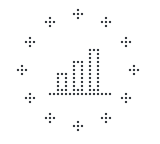

<div align="center">

<picture>
  <source media="(prefers-color-scheme: dark)" srcset="assets/icon-dark.svg">
  
</picture>

<h1>𝙋𝙤𝙧𝙩𝙖𝙡 𝙋𝙍𝙍</h1>
<h3>EU Recovery and Resilience Facility Dashboard</h3>


*Academic project developed for **Interface Pessoa-Máquina** @ University of Minho*  
*Final grade: **18/20** ⭐*

</div>

---

## 🎬 Demo

<div align="center">

[](https://youtu.be/yCtLdJ1a8jI)

*Click the image to watch our presentation video on YouTube (6m 42s)*

</div>

---

## 📊 About

For Human-Computer Interaction we designed and built a portal to follow how the EU Recovery and Resilience funds are being spent across the **27 member states**: which milestones each country has reached, how much money has already been paid out, and how the common indicators are evolving.

We did it in two phases. First came the research, with three personas and a prototype in **Figma**. Then we turned that prototype into a real web app in **Vue 3**, with the data served by a small mock API.

---

## ⚡ What it does

- a **dashboard** with the big numbers and charts per investment pillar
- **milestones and targets** with filters, progress charts, a revision history for each milestone and export to CSV, JSON and PDF
- **disbursements**, with the payments made by the European Commission by year and type, the top beneficiaries and the history of tranches
- the 14 **common indicators** per country and per semester
- an interactive **map of the EU**, where you click a country to open its page
- a **comparison** page that puts two countries side by side with an animated scorecard
- an **FAQ** page
- dark mode, Portuguese and English, a splash screen, a custom 404 page and friendly error messages when the API is down

---

## 🧩 My part

I built the app layout and routing, the interactive map, the country pages, the comparison page, the milestones page and the FAQ, and I set up the base of the data. I also edited the presentation video.

---

## 🗺️ The fun part

The map took me way more attempts than I'd like to admit. The first version had countries in the wrong places, the second one was a map full of pins that looked nothing like the rest of the site, and only the third one, drawn with D3 from GeoJSON, finally looked right. Clicking a country and landing on its page is still my favourite thing in the whole app.

My favourite bug happened on the day of the defence: the comparison page suddenly showed up blank. A cleanup commit had deleted one single line, the variable that handled API errors, and everything below it stopped working. Going through the git history to find it a few hours before presenting was stressful, but it taught me to love `git log`.

---

## 🚀 How to Run

```bash
# Install dependencies
npm install

# Run the app and the mock API together
npm run dev:all
```

The app opens at `http://localhost:5173` and the API runs at `http://localhost:3001`.

You can also run them in separate terminals:

```bash
npm run dev:api    # json-server
npm run dev        # Vue app
```

---

## 🗂️ Project Structure

```
.
├── src/
│   ├── views/        # one page per section
│   ├── components/   # navbar, sidebar, footer, map, splash screen
│   ├── layouts/      # main app layout
│   ├── router/       # routes
│   ├── stores/       # Pinia store with the theme and PT/EN translations
│   ├── services/     # calls to the API
│   ├── assets/       # global styles and dark mode
│   └── main.js
├── db.json           # data served by json-server
└── package.json
```

---

## 🛠️ Tech Stack

`Vue 3` · `Composition API` · `Vue Router` · `Pinia` · `PrimeVue` · `Chart.js` · `D3.js` · `json-server` · `Vite` · `Figma`

---

## 👩‍💻 Authors

**Carolina Dias** · [@carolinavdias](https://github.com/carolinavdias)  
**Ana Patrícia Machado** · [@apatriciamachado](https://github.com/apatriciamachado)  
**Alexandra Neves** · [@xana06](https://github.com/xana06)

<p align="center"><i>27 countries, way too many milestones</i></p>
